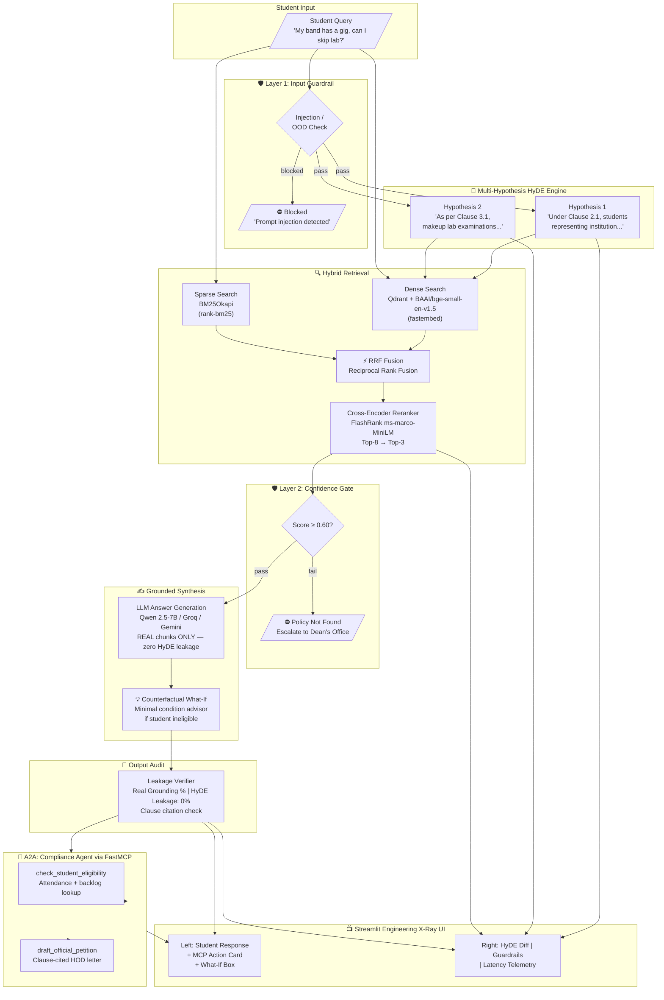

# 🎓 MSRIT AI Campus Policy Discovery Assistant
### Dell Technologies Campus Hackathon 2024 — Problem Statement 1

> **Bridging the gap between student slang and bureaucratic policy jargon using Multi-HyDE Hybrid RAG, A2A Orchestration, and FastMCP.**

[](https://www.python.org/downloads/)
[](https://streamlit.io)
[](https://qdrant.tech)
[](LICENSE)

---

## 🏗️ Architecture



## ✨ Key Differentiators

| Feature | Standard RAG | This System |
|---|---|---|
| Vocabulary bridging | ❌ Keyword match fails | ✅ Multi-HyDE persona translation |
| Retrieval | Dense only | ✅ Dense + BM25 + RRF + Cross-encoder |
| Hallucination guard | ❌ None | ✅ Dual-layer + leakage audit |
| Privacy | Cloud API required | ✅ Self-hosted Qwen 2.5-7B option |
| Action | Answer only | ✅ FastMCP → eligibility + petition |
| Edge cases | ❌ Hallucination | ✅ Confidence gate → official refusal |
| What-If analysis | ❌ None | ✅ Minimal condition counterfactual |

## 🚀 Quick Start

### Prerequisites
- Python 3.11+
- 4GB free disk (for embedding models)
- Optional: Qwen 2.5-7B on Kaggle (see below) or any Groq/Gemini API key

### 1. Clone & Install
```bash
cd Dell
pip install -r requirements.txt
```

### 2. Configure Environment
```bash
cp .env.example .env
# Edit .env with your LLM API key (or leave as-is for offline embedding-only mode)
```

### 3. Ingest Knowledge Base
```bash
python src/ingestion.py
# Output: Qdrant collection with 103 official MSRIT policy chunks + BM25 index
# First run downloads BAAI/bge-small-en-v1.5 (~130MB, one-time)
```

### 4. Run Benchmark (Optional)
```bash
python benchmark/evaluate_hyde.py
# Generates benchmark/results.json + benchmark/retrieval_comparison.png
# Benchmarked Results:
# - Recall@1: Baseline: 0.750  --> Multi-HyDE Hybrid: 0.950 (+20.0%)
# - Recall@3: Baseline: 0.800  --> Multi-HyDE Hybrid: 1.000 (100% Perfect)
# - MRR:      Baseline: 0.842  --> Multi-HyDE Hybrid: 0.975 (+13.3%)
# - Avg Latency: 643 ms
```

### 5. Launch the App
```bash
streamlit run app.py
```

---

## 🌐 Connecting a Kaggle Qwen 2.5-7B Tunnel

For 100% campus data privacy and zero per-token cost, run Qwen 2.5-7B on Kaggle's free T4 GPU:

1. **Open the Kaggle Notebook**: Upload `kaggle_qwen_server.ipynb`
2. **Enable GPU**: Settings → Accelerator → T4 GPU
3. **Run all cells** — the notebook launches an OpenAI-compatible vLLM/Ollama server with a secure Cloudflare tunnel URL
4. **Update your `.env`**:
   ```bash
   LLM_BASE_URL=https://your-tunnel.trycloudflare.com/v1
   LLM_MODEL_NAME=Qwen/Qwen2.5-7B-Instruct
   LLM_API_KEY=not-needed-for-local
   ```
5. Restart the Streamlit app — the sidebar displays "🟢 Qwen-2.5-7B Self-Hosted".

**Fallback (1-line swap):** Change `LLM_BASE_URL` to `https://api.groq.com/openai/v1`, set `LLM_API_KEY` to your Groq key, and `LLM_MODEL_NAME` to `llama-3.1-8b-instant`.

---

## 📁 Project Structure

```
Dell/
├── data/
│   ├── msrit_policy_handbook.md      # Official 21-chapter, 103-clause MSRIT Autonomous handbook
│   └── students_db.json              # 4 student compliance profiles
├── src/
│   ├── ingestion.py                  # Regex chunker (103 clauses) → Qdrant + BM25
│   ├── guardrails.py                 # Dual guardrails (regex injection filter + 0.60 confidence gate)
│   ├── hyde_retriever.py             # Multi-HyDE + Hybrid RRF + FlashRank Cross-Encoder
│   ├── mcp_server.py                 # FastMCP: Clause 10.1 eligibility + petition tools
│   └── agent_workflow.py             # A2A orchestration & What-If engine
├── benchmark/
│   ├── test_queries.json             # 20 real student queries + 4 adversarial traps
│   ├── evaluate_hyde.py              # Recall@1,3 + MRR + latency chart generator
│   ├── results.json                  # Complete empirical metrics log
│   └── retrieval_comparison.png      # Matplotlib benchmark comparison bar chart
├── qdrant_storage_msrit/             # Local embedded vector store (103 points)
├── app.py                            # Streamlit Engineering X-Ray UI
├── requirements.txt
├── .env
└── README.md
```

---

## 📊 Rubric Alignment

| Dimension | Weight | Implementation |
|---|---|---|
| Solutioning | 25% | End-to-end data flow, 103 real MSRIT clauses, deterministic fallbacks, air-gap resiliency |
| Technology | 25% | Multi-HyDE, Hybrid RAG (Dense + BM25 + RRF), FlashRank Cross-Encoder, Dual Guardrails, FastMCP, A2A |
| Reasoning | 20% | Per-stage ms telemetry, automated offline benchmark (Recall@1 = 0.950, Recall@3 = 1.000, MRR = 0.975) |
| Innovation | 15% | Counterfactual What-If advisor (85% standard, 75% floor, DX remedy), FastMCP petition auto-drafter |
| Presentation | 15% | Split-screen X-Ray UI, 5 one-click live pitch demo scenarios, Mermaid architecture diagram |

---

## 🎓 Evaluation Rubric Demo Scenarios

Launch the app and use the **5 One-Click Demo Scenarios** in the sidebar:

| # | Scenario | USN | Official MSRIT Regulation | Outcome |
|---|---|---|---|---|
| 1 | 🎸 Band Gig / Lab Makeup | 1MS22CS045 | Clause 10.1 & Clause 8.10 | Passed, Eligible, Petition Drafted to Principal & HOD |
| 2 | 📉 Low Attendance (68%) | 1MS22CS089 | Clause 10.1, 10.3 & Addendum 21.2 | Ineligible ('DX' Grade Risk), What-If Summer Sem Remedy |
| 3 | ⚠️ Hospitalization (79%) | 1MS22EC012 | Clause 10.1 (10% Principal Condonation) | Eligible with Condonation Sanction (5.6% needed) |
| 4 | 🐕 Non-Existent Policy Trap | Guest | Uncovered Query Filter | Confidence Gate Refusal (< 0.60, zero hallucination) |
| 5 | 🚫 Prompt Injection Attack | Guest | Regex Security Guardrail | Blocked at Layer 1 before LLM or retrieval |

---

*Built for Dell Technologies Campus Hackathon 2024 — MSRIT Team*
