# 🎓 MSRIT AI Campus Policy Discovery Assistant
### Enterprise Policy Discovery Engine for Autonomous Regulations

> **Bridging the vocabulary gap between casual student language and formal statutory university regulations using Multi-HyDE Hybrid RAG, Dual-Layer Guardrails, and FastMCP Agent-to-Agent Compliance.**

[](https://www.python.org/downloads/)
[](https://streamlit.io)
[](https://qdrant.tech)
[](LICENSE)

---

## 📌 Executive Overview

Students frequently struggle to navigate dense institutional handbooks. When a student asks a casual or hypothetical question (*"My band has a gig next Friday, can I skip my lab and make it up later?"*), standard search tools fail because official regulations use dense academic terminology (*"Intermittent Academic Accommodations under Clause 10.1"*). Generic LLMs, on the other hand, often hallucinate false permissions without source grounding.

This system provides a production-grade, zero-hallucination solution that:
1. **Translates** informal student inquiries into formal statutory hypotheses using **Multi-Hypothesis HyDE**.
2. **Retrieves** verified policy clauses via a **Three-Tier Hybrid Engine** (Dense vector search + Sparse BM25 + Reciprocal Rank Fusion + FlashRank Cross-Encoder reranking).
3. **Guarantees safety** through **Dual-Layer Guardrails** (pre-LLM prompt injection filtering and a 0.60 confidence gate that deterministically refuses uncodified topics).
4. **Executes compliance actions** via **FastMCP Agent-to-Agent (A2A)** tools to check student eligibility against attendance floors and generate official petitions.
5. **Advises alternative paths** through a counterfactual **What-If Engine** (surfacing Summer Remedial Semesters under Addendum 21.2 for debarment risks).

---

## 🏗️ System Architecture

```mermaid
flowchart LR
    subgraph INPUT["① Input Layer"]
        U["🎓 Student Query\n'Can I skip lab for band gig?'"]
        G1["🛡️ Layer 1 Guardrail\nPrompt Injection Filter"]
        U --> G1
    end

    subgraph HYDE["② Multi-HyDE Engine"]
        H1["Hypothesis 1\nRegistrar Lens"]
        H2["Hypothesis 2\nExamination Controller"]
        G1 -->|"✅ Clean"| H1
        G1 -->|"✅ Clean"| H2
    end

    subgraph RETRIEVAL["③ Hybrid Retrieval"]
        V["Qdrant Vector DB\n(BAAI/bge-small-en-v1.5)"]
        B["BM25Okapi Index\n(103 Statutory Clauses)"]
        RRF["RRF Fusion (k=60)\n+ FlashRank Cross-Encoder"]
        H1 --> V
        H2 --> V
        H1 --> B
        H2 --> B
        V --> RRF
        B --> RRF
    end

    subgraph GATE["④ Confidence Gate"]
        CG{"Score ≥ 0.60?"}
        RRF --> CG
    end

    subgraph AGENT["⑤ Agent Layer"]
        PA["Policy Discovery Agent\n(Grounded Synthesis)"]
        CA["Compliance Agent\n(FastMCP Tools)"]
        WI["What-If Counterfactual\nAdvisor"]
        CG -->|"✅ Pass"| PA
        PA --> CA
        PA --> WI
    end

    subgraph OUTPUT["⑥ Output"]
        ANS["📋 Verified Ruling\n+ Clause Citations"]
        PET["📄 Official Petition (.txt)"]
        REF["⛔ Deterministic Refusal\n(Low Confidence)"]
        CA --> ANS
        CA --> PET
        CG -->|"❌ Fail"| REF
    end

    style INPUT fill:#0f172a,stroke:#0076CE,color:#F3F4F6
    style HYDE fill:#0f172a,stroke:#7c3aed,color:#F3F4F6
    style RETRIEVAL fill:#0f172a,stroke:#0891b2,color:#F3F4F6
    style GATE fill:#0f172a,stroke:#d97706,color:#F3F4F6
    style AGENT fill:#0f172a,stroke:#059669,color:#F3F4F6
    style OUTPUT fill:#0f172a,stroke:#0076CE,color:#F3F4F6
```



---

## ✨ Key Technical Innovations

| Component | Standard Implementation | This Architecture |
|---|---|---|
| **Semantic Bridging** | Raw query embedded directly | **Multi-HyDE**: Dual bureaucratic hypotheses (Registrar & Controller of Examinations lenses) |
| **Retrieval Strategy** | Dense-only search | **Hybrid RAG**: Dense (Qdrant) + Lexical (BM25Okapi) $\to$ RRF ($k=60$) $\to$ FlashRank Cross-Encoder |
| **Hallucination Control** | System prompt instructions | **Architectural Isolation**: 0.0% HyDE assumption leakage; synthetic hypotheses are strictly quarantined from synthesis |
| **Edge-Case Handling** | LLM guesses uncodified topics | **Layer 2 Confidence Gate**: Relevance score $< 0.60$ triggers deterministic refusal (e.g. pets in labs) |
| **Security** | None or simple keyword filter | **Layer 1 Input Guardrail**: Intercepts injections & roleplay attacks at boundary (0 GPU tokens consumed) |
| **Agentic Action** | Conversational responses only | **FastMCP (A2A)**: Evaluates student database records & auto-drafts formal, signature-ready petitions |
| **Academic Guidance** | Static policy citation | **Counterfactual What-If Advisor**: Identifies minimal qualifying conditions and remedial pathways |

---

## 📈 Quantitative Benchmark Results

Evaluated across an institutional benchmark of **20 verified academic queries** plus **4 adversarial trap queries** from the MSRIT Autonomous Regulations:

| Evaluation Metric | Raw Dense Baseline | Multi-HyDE Hybrid RAG | Absolute Gain | Status |
|:---|:---:|:---:|:---:|:---:|
| **Recall@1** | 0.750 | **0.950** | **+20.0%** | Significant Precision Lift |
| **Recall@3** | 0.800 – 0.950 | **1.000** | **+5.0% to +20.0%** | **100% Perfect Coverage** |
| **Mean Reciprocal Rank (MRR)** | 0.842 | **0.975** | **+0.133** | Correct Clause at Rank 1 |
| **HyDE Assumption Leakage** | N/A | **0.00%** | — | Verified Architectural Isolation |
| **Prompt Injection Interception** | 0% (vulnerable) | **100.0%** | — | Blocked at Pre-LLM Boundary |
| **Uncodified Policy Refusal** | 0% (hallucinates) | **100.0%** | — | Intercepted by 0.60 Confidence Gate |

---

## 📁 Repository Structure

```text
├── .env.example                          # Environment variable configuration template
├── .gitignore                            # Standardized git exclusions (secrets, caches, local files)
├── .streamlit/
│   └── config.toml                       # Dell enterprise dark-mode theme configuration
├── benchmark/
│   ├── evaluate_hyde.py                  # Benchmark harness (evaluates Recall@1, Recall@3, MRR)
│   ├── results.json                      # Empirical test benchmark results
│   ├── retrieval_comparison.png          # Visual benchmark comparison chart
│   └── test_queries.json                 # 24 standardized test cases & ground truths
├── data/
│   ├── msrit_policy_handbook.md          # 103 codified statutory clauses (21 chapters)
│   └── students_db.json                  # Sample test student compliance profiles
├── qdrant_storage_msrit/                 # Embedded Qdrant vector database & BM25 pickle
├── src/
│   ├── agent_workflow.py                 # Policy Discovery & Compliance Orchestrator
│   ├── guardrails.py                     # Layer 1 injection filter + Layer 2 confidence gate
│   ├── hyde_retriever.py                 # Multi-HyDE + BM25 + FlashRank Cross-Encoder reranker
│   ├── ingestion.py                      # Handbook chunking & vector ingestion pipeline
│   └── mcp_server.py                     # FastMCP tool suite (eligibility & petition drafter)
├── app.py                                # Streamlit production web application
├── kaggle_server.py                      # Self-hosted Ollama + dual-T4 GPU inference script
└── requirements.txt                      # Pinned production dependencies
```

---

## 🚀 Quick Start

### 1. Prerequisites
- Python 3.11 or higher
- 4 GB free disk space (for local FastEmbed & Cross-Encoder models)

### 2. Installation
```bash
git clone https://github.com/<your-username>/<your-repo-name>.git
cd <your-repo-name>
pip install -r requirements.txt
```

### 3. Environment Configuration
Copy the configuration template to `.env`:
```bash
cp .env.example .env
```
Default parameters in `.env`:
```env
LLM_BASE_URL=https://cornstalk-prescribe-propeller.ngrok-free.dev/v1
LLM_MODEL_NAME=qwen3.8:27b
LLM_API_KEY=ollama
QDRANT_PATH=./qdrant_storage_msrit
QDRANT_COLLECTION=msrit_policies
CONFIDENCE_THRESHOLD=0.60
TOP_K_RERANK=8
FINAL_TOP_K=3
```
> **Note on Offline Resilience:** If no remote LLM server is active, the application automatically operates in **Deterministic Offline Fallback Mode**—answering queries with 100% real policy grounding directly from retrieved statutory clauses.

### 4. Knowledge Base Ingestion (Optional)
The repository includes a pre-indexed `qdrant_storage_msrit/` directory. To re-index the handbook from scratch:
```bash
python src/ingestion.py
```

### 5. Running the Web Application
Launch the Streamlit user interface:
```bash
streamlit run app.py
```
Open your browser at `http://localhost:8501`.

---

## ⚡ Self-Hosted GPU Inference (Kaggle Dual-T4 Setup)

For complete campus data privacy and zero API token cost, the foundation model can be self-hosted on dual NVIDIA Tesla T4 GPUs on Kaggle:

1. Create a Kaggle notebook with **GPU T4 x2** accelerator and **Internet = On**.
2. Run the provided [kaggle_server.py](kaggle_server.py) script.
3. The script configures `OLLAMA_FLASH_ATTENTION=1`, `OLLAMA_KV_CACHE_TYPE=q8_0`, launches Ollama with `qwen3.8:27b`, and tunnels the API securely using ngrok with `--host-header=rewrite` (bypassing host-header filtering).
4. Update `LLM_BASE_URL` in `.env` with your tunnel endpoint. The Streamlit header badge will automatically reflect **🟢 Online**.

---

## 🧪 Evaluation & Benchmarking

To execute the automated benchmark suite comparing raw baseline retrieval against Multi-HyDE Hybrid search:

```bash
python benchmark/evaluate_hyde.py
```

The script processes all 20 test queries, logs per-query results to `benchmark/results.json`, and updates `benchmark/retrieval_comparison.png`.

---

## 📄 License

This project is licensed under the [MIT License](LICENSE).
